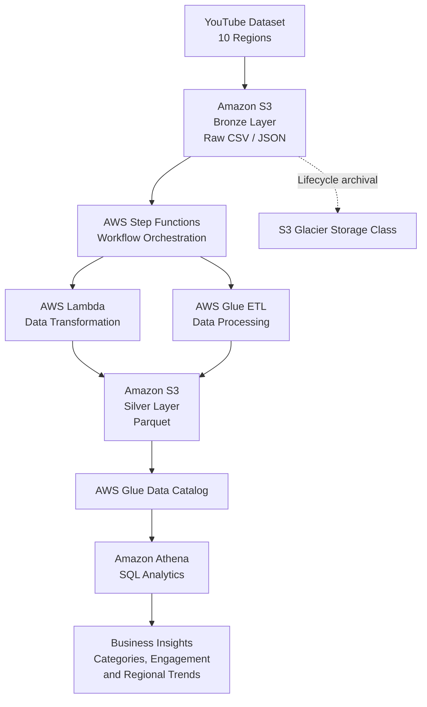

# YouTube Data Engineering Pipeline on AWS
## Architecture


An end-to-end data engineering project that processes YouTube trending video data across 10 regions using AWS services. The pipeline uses Medallion Architecture to organize raw and processed data and enables SQL analytics using Amazon Athena.

## Table of Contents
- [Project Overview](#project-overview)
- [Business Objective](#business-objective)
- [Architecture](#architecture)
- [Technology Stack](#technology-stack)
- [Data Pipeline Workflow](#data-pipeline-workflow)
- [Medallion Architecture](#medallion-architecture)
- [Why Parquet Instead of JSON?](#why-parquet-instead-of-json)
- [Amazon S3 Glacier](#amazon-s3-glacier)
- [Analytics and Business Insights](#analytics-and-business-insights)
- [Key Learnings](#key-learnings)

## Project Overview

This project demonstrates how AWS cloud services can build an automated data pipeline for YouTube analytics. Region-specific datasets are stored in Amazon S3, processed using AWS Lambda and AWS Glue, orchestrated through AWS Step Functions, and queried using Amazon Athena.

## Business Objective

### Problem Statement

The goal is to support **data-driven advertising campaigns on YouTube** by understanding video popularity and performance.

Key questions:
1. How can videos be categorized using comments, statistics, and other attributes?
2. Which factors are associated with video popularity, including views, likes, comments, and category?
3. How does video performance differ across regions?
4. How can these insights guide advertising campaign decisions?

The pipeline prepares structured data for analysis. Identifying causal effects on popularity requires additional statistical analysis or machine learning.

## Architecture



## Technology Stack

| Component | Technology |
|---|---|
| Cloud Platform | AWS |
| Data Storage | Amazon S3 |
| Serverless Processing | AWS Lambda |
| ETL | AWS Glue |
| Orchestration | AWS Step Functions |
| Metadata | AWS Glue Data Catalog |
| SQL Analytics | Amazon Athena |
| Language | Python |
| Data Formats | CSV, JSON, Parquet |
| Libraries | Boto3, AWS Data Wrangler |
| Architecture | Medallion Architecture |

## Data Pipeline Workflow

### Bronze Layer (Raw Data)

The ingestion Lambda (`youtube_api_integstion`) fetches data from the YouTube Data API v3.

- **Trending videos:** Top 50 trending videos per region.
- **Category mappings:** Video category ID-to-name reference data.
- **Historical data:** Kaggle CSV datasets uploaded using the `aws_copy.sh` script.

Raw JSON data is stored in Amazon S3, organized by region, date, and hour where applicable.

Example S3 paths:

```text
s3://bronze-bucket/youtube/raw_statistics/region=US/date=2026-04-01/hour=12/
s3://bronze-bucket/youtube/raw_statistics_reference_data/region=US/
```

The Bronze layer preserves source data for auditing and reprocessing.

### Silver Layer (Cleansed Data)

Two transformations process Bronze data.

#### 1. Statistics - AWS Glue Job: `bronze_to_silver_statistics`

- Enforces a consistent schema across supported API JSON and Kaggle CSV formats.
- Casts numerical fields such as views and likes to appropriate integer types.
- Parses trending dates into consistent date values.
- Handles null values and standardizes region identifiers.
- Deduplicates records, retaining the latest record per video, region, and date.
- Calculates derived metrics such as `like_ratio` and `engagement_rate`.
- Writes Parquet files with Snappy compression, partitioned by region.

#### 2. Reference Data - AWS Lambda: `json_to_parquet`

- Normalizes category mapping JSON into tabular data.
- Deduplicates category entries.
- Converts JSON to Parquet format.
- Writes processed reference data to Silver, partitioned by region.

### Data Quality Gate

Before Gold aggregation, the Data Quality Lambda (`dq_lambda`) validates Silver data.

| Check | Validation Rule |
|---|---|
| Row count | At least 10 rows |
| Null percentage | No more than 5% in critical columns |
| Schema validation | Required columns are present |
| Value ranges | Sanity checks on view counts |
| Data freshness | Latest data is less than 48 hours old |

**On success:** The workflow continues to Gold aggregation.

**On failure:** Gold processing is halted and an Amazon SNS alert is sent with failure details.

### Gold Layer (Business Aggregations)

The AWS Glue job (`silver_to_gold_analytics`) aggregates validated Silver data into three analytics tables for regional, channel-level, and category-level analysis.

## Gold Layer Output Tables

### 1. `trending_analytics`

Daily trending metrics aggregated by region and trending date.

| Column | Description |
|---|---|
| `region` | Country code, such as US, GB, or IN |
| `trending_date_parsed` | Date of the trending snapshot |
| `total_videos` | Number of trending videos |
| `total_views` | Sum of views |
| `total_likes` | Sum of likes |
| `avg_views_per_video` | Average views per trending video |
| `avg_like_ratio` | Average like-to-view ratio |
| `avg_engagement_rate` | Average engagement rate |
| `unique_channels` | Number of distinct channels |
| `unique_categories` | Number of distinct categories |

**Use case:** Compare trending activity and engagement across regions and dates.

### 2. `channel_analytics`

Channel-level performance metrics and regional rankings.

| Column | Description |
|---|---|
| `channel_title` | YouTube channel name |
| `region` | Country code |
| `total_videos` | Number of videos that trended |
| `total_views` | Total views across trending videos |
| `avg_engagement_rate` | Average engagement rate |
| `times_trending` | Number of trending appearances |
| `rank_in_region` | Performance rank within the region |
| `categories` | Categories associated with the channel |

**Use case:** Identify channels with strong trending performance and compare channel metrics within each region.

### 3. `category_analytics`

Category-level performance and share of total views.

| Column | Description |
|---|---|
| `category` | Video category name |
| `region` | Country code |
| `trending_date_parsed` | Date of the trending snapshot |
| `video_count` | Number of videos in the category |
| `total_views` | Total views for the category |
| `avg_engagement_rate` | Average engagement rate |
| `view_share_pct` | Percentage of total views attributed to the category |

**Use case:** Compare category performance and identify categories with a high share of trending-video views.

### Gold Storage and Querying

All Gold tables are stored in Parquet format with Snappy compression, partitioned by region, and registered in the AWS Glue Data Catalog for querying through Amazon Athena.


## Medallion Architecture

Medallion Architecture organizes data into three layers.

### Bronze Layer — Raw Data
- Stores original CSV and JSON files.
- Preserves source data.
- Supports future reprocessing.

### Silver Layer — Cleaned Data
- Normalizes JSON records.
- Standardizes schemas and data types.
- Handles missing or inconsistent values where required.
- Stores structured datasets in Parquet format.

### Gold Layer — Analytics-Ready Data
Potential business-focused datasets include:
- Video performance and engagement metrics.
- Category-level popularity analysis.
- Regional performance comparisons.
- Features for investigating factors associated with popularity.

The Gold layer should be implemented before claiming these outputs are available.

## Why Parquet Instead of JSON?

| Feature | JSON | Parquet |
|---|---|---|
| File size | 7.9 KB | 7.1 KB |
| Format | Text-based | Binary, columnar |
| Human-readable | Yes | Requires a compatible tool |
| Selected-column reads | Usually parses JSON records | Reads only required columns |
| Compression | Depends on encoding and storage | Supports efficient compression |
| Athena analytics | Supported, but may parse more data | Well suited to analytical queries |
| Schema and types | Flexible; often inferred | Stores schema and typed columns |

### Why Parquet Is Useful

**1. Columnar storage:** Analytical queries can read only the required columns.

**2. Query performance:** Column pruning and compression can reduce the data scanned for suitable workloads.

**3. Compression:** Parquet supports codecs such as Snappy, reducing storage requirements in many cases.

**4. Schema support:** Stores column types and schema information for structured processing.

**5. Athena cost optimization:** On-demand Athena queries are generally charged according to data scanned. Parquet can reduce scanning and costs for analytical workloads.

**Conclusion:** The file size decreases from 7.9 KB to 7.1 KB, approximately 10.1%. The size reduction is small, but Parquet is valuable because of its columnar layout, compression, schema support, and suitability for analytical queries. Benefits become more significant with larger datasets.

## Amazon S3 Glacier

Amazon S3 Glacier storage classes are designed for long-term data retention when data is accessed infrequently.

Benefits:
- Lower storage costs for suitable archival workloads.
- Retention of historical datasets.
- Lifecycle management of older data.
- Separation of frequently queried data from archival data.

## Analytics and Business Insights

The processed data can support analysis of:
- Video categories with high average views.
- Regional engagement differences.
- Relationships between views, likes, and comments.
- Channel performance and trending patterns.
- Characteristics that may help guide advertising campaigns.

## Key Learnings

- Building an AWS-based data pipeline.
- Applying Medallion Architecture.
- Converting JSON data into Parquet.
- Managing data and metadata using S3 and AWS Glue.
- Orchestrating workflows with Step Functions.
- Querying data using Athena and SQL.
- Understanding analytical and archival storage trade-offs.
- Preparing data for regional and category-level YouTube analytics.

## Conclusion

This project demonstrates an AWS-based approach to transforming YouTube datasets from 10 regions into structured data for analytics. Amazon S3, Lambda, Glue, Step Functions, and Athena provide a foundation for data processing and data-driven advertising analysis, while Parquet supports analytical workloads and Glacier storage classes offer long-term archival options.
