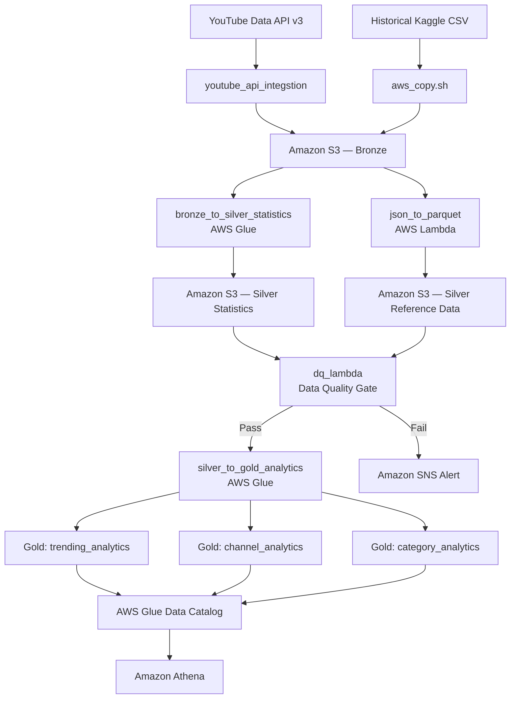

## Data Flow

The pipeline follows a Medallion Architecture with three layers: Bronze (raw data), Silver (cleansed data), and Gold (business-ready analytics). AWS Step Functions orchestrates the workflow, while Lambda and AWS Glue handle ingestion, transformation, validation, and aggregation.



### Bronze Layer (Raw Data)

The ingestion Lambda (`youtube_api_integstion`) fetches data from the YouTube Data API v3.

- **Trending videos:** Top 50 trending videos per region.
- **Category mappings:** Video category ID-to-name reference data.
- **Historical data:** Kaggle CSV datasets uploaded through the `aws_copy.sh` script.

Raw JSON data is stored in Amazon S3, organized by region, date, and hour where applicable.

Example S3 paths:

```text
s3://bronze-bucket/youtube/raw_statistics/region=US/date=2026-04-01/hour=12/
s3://bronze-bucket/youtube/raw_statistics_reference_data/region=US/
```

The Bronze layer preserves source data for auditing and reprocessing.

### Silver Layer (Cleansed Data)

Two transformations process Bronze data.

#### 1. Statistics — AWS Glue Job: `bronze_to_silver_statistics`

This job standardizes YouTube statistics from API JSON and historical Kaggle CSV datasets.

- Enforces a consistent schema across supported input formats.
- Casts numerical fields such as views and likes to appropriate integer types.
- Parses trending dates into consistent date values.
- Handles null values and standardizes region identifiers.
- Removes duplicates, retaining the latest record per video, region, and date.
- Calculates derived metrics such as `like_ratio` and `engagement_rate`.
- Writes cleansed data in Parquet format with Snappy compression, partitioned by region.

#### 2. Reference Data — AWS Lambda: `json_to_parquet`

This Lambda function processes video category reference JSON files.

- Normalizes category mappings into tabular data.
- Deduplicates category entries.
- Converts JSON to Parquet format.
- Writes the processed reference data to the Silver layer, partitioned by region.

### Data Quality Gate

Before Gold aggregation, the Data Quality Lambda (`dq_lambda`) validates the Silver datasets.

| Check | Validation Rule |
|---|---|
| Row count | At least 10 rows |
| Null percentage | No more than 5% in critical columns |
| Schema validation | Required columns are present |
| Value ranges | Sanity checks on view counts |
| Data freshness | Latest data is less than 48 hours old |

**On success:** The workflow continues to the Gold aggregation job.

**On failure:** The pipeline halts the Gold processing path and sends an Amazon SNS alert containing failure details.

These thresholds represent the configured validation rules and should match the actual Lambda implementation.

### Gold Layer (Business Aggregations)

The AWS Glue job (`silver_to_gold_analytics`) aggregates validated Silver data into three analytics tables for regional, channel-level, and category-level analysis.

## Gold Layer Output Tables

### 1. `trending_analytics`

Daily trending metrics aggregated by region and trending date.

| Column | Description |
|---|---|
| `region` | Country code, such as US, GB, or IN |
| `trending_date_parsed` | Date of the trending snapshot |
| `total_videos` | Number of trending videos |
| `total_views` | Sum of views |
| `total_likes` | Sum of likes |
| `avg_views_per_video` | Average views per trending video |
| `avg_like_ratio` | Average like-to-view ratio |
| `avg_engagement_rate` | Average engagement rate |
| `unique_channels` | Number of distinct channels |
| `unique_categories` | Number of distinct categories |

**Use case:** Compare trending activity and engagement across regions and dates.

### 2. `channel_analytics`

Channel-level performance metrics and regional rankings.

| Column | Description |
|---|---|
| `channel_title` | YouTube channel name |
| `region` | Country code |
| `total_videos` | Number of videos that trended |
| `total_views` | Total views across trending videos |
| `avg_engagement_rate` | Average engagement rate |
| `times_trending` | Number of trending appearances |
| `rank_in_region` | Performance rank within the region |
| `categories` | Categories associated with the channel |

**Use case:** Identify channels with strong trending performance and compare channel metrics within each region.

### 3. `category_analytics`

Category-level performance and share of total views.

| Column | Description |
|---|---|
| `category` | Video category name |
| `region` | Country code |
| `trending_date_parsed` | Date of the trending snapshot |
| `video_count` | Number of videos in the category |
| `total_views` | Total views for the category |
| `avg_engagement_rate` | Average engagement rate |
| `view_share_pct` | Percentage of total views attributed to the category |

**Use case:** Compare category performance and identify categories with a high share of trending-video views.

### Gold Storage and Querying

All Gold tables are stored in Parquet format with Snappy compression, partitioned by region, and registered in the AWS Glue Data Catalog for querying through Amazon Athena.

The Gold layer enables SQL-based analysis without repeatedly processing the raw Bronze datasets.

## Business Questions and Analytics

The Gold tables support the project's objective of making YouTube advertising decisions more data-driven.

- **Regional trends:** Which regions have the highest trending-video activity?
- **Channel performance:** Which channels appear frequently in trending results?
- **Category performance:** Which categories account for the largest share of views?
- **Engagement:** How do likes and comments relate to video views?
- **Campaign planning:** Which categories and regional trends merit further investigation for advertising opportunities?

These analytics describe patterns in trending-video data. They do not, by themselves, establish that a particular category or engagement metric causes popularity or guarantees advertising success.
