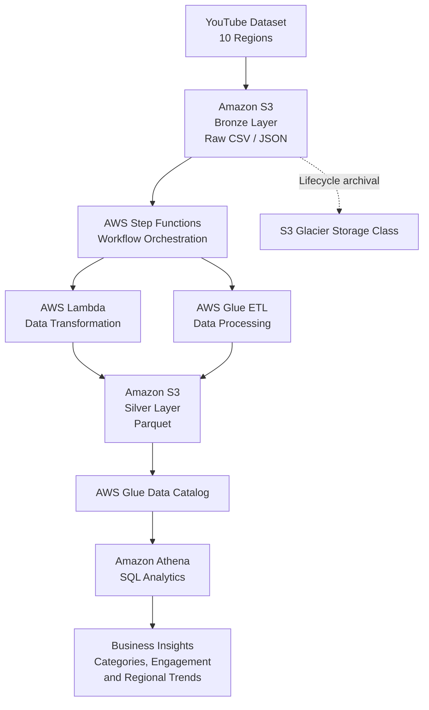

# YouTube Data Engineering Pipeline on AWS

An end-to-end data engineering project that processes YouTube trending video data across 10 regions using AWS services. The pipeline uses Medallion Architecture to organize raw and processed data and enables SQL analytics using Amazon Athena.

## Table of Contents
- [Project Overview](#project-overview)
- [Business Objective](#business-objective)
- [Architecture](#architecture)
- [Technology Stack](#technology-stack)
- [Data Pipeline Workflow](#data-pipeline-workflow)
- [Medallion Architecture](#medallion-architecture)
- [Why Parquet Instead of JSON?](#why-parquet-instead-of-json)
- [Amazon S3 Glacier](#amazon-s3-glacier)
- [Analytics and Business Insights](#analytics-and-business-insights)
- [Key Learnings](#key-learnings)

## Project Overview

This project demonstrates how AWS cloud services can build an automated data pipeline for YouTube analytics. Region-specific datasets are stored in Amazon S3, processed using AWS Lambda and AWS Glue, orchestrated through AWS Step Functions, and queried using Amazon Athena.

## Business Objective

### Problem Statement

The goal is to support **data-driven advertising campaigns on YouTube** by understanding video popularity and performance.

Key questions:
1. How can videos be categorized using comments, statistics, and other attributes?
2. Which factors are associated with video popularity, including views, likes, comments, and category?
3. How does video performance differ across regions?
4. How can these insights guide advertising campaign decisions?

The pipeline prepares structured data for analysis. Identifying causal effects on popularity requires additional statistical analysis or machine learning.

## Architecture



## Technology Stack

| Component | Technology |
|---|---|
| Cloud Platform | AWS |
| Data Storage | Amazon S3 |
| Serverless Processing | AWS Lambda |
| ETL | AWS Glue |
| Orchestration | AWS Step Functions |
| Metadata | AWS Glue Data Catalog |
| SQL Analytics | Amazon Athena |
| Language | Python |
| Data Formats | CSV, JSON, Parquet |
| Libraries | Boto3, AWS Data Wrangler |
| Architecture | Medallion Architecture |

## Data Pipeline Workflow

### 1. Data Ingestion — Bronze
- Collect region-specific YouTube datasets from 10 regions.
- Store raw CSV and JSON files in Amazon S3.
- Preserve source data for reprocessing and auditing.

### 2. Workflow Orchestration
AWS Step Functions coordinates processing tasks, manages execution order, and supports monitoring, retries, and error handling when configured.

### 3. Data Transformation
AWS Lambda and AWS Glue perform appropriate transformations:
- Read source files from S3.
- Normalize JSON records.
- Standardize fields and data types.
- Convert suitable datasets into Parquet.
- Write processed files to the Silver layer.

### 4. Processed Storage — Silver
Store cleaned and structured datasets in Amazon S3 in Parquet format.

Example S3 organization:

```text
s3://yt-data-bronze-europe/
    youtube/raw_statistics/

s3://yt-data-silver-europe/
    youtube/reference_data/
        region=in/
            part-00000.parquet
```

Adjust paths to match your actual bucket structure.

### 5. Metadata and Analytics
AWS Glue Data Catalog maintains table schemas and metadata. Amazon Athena uses SQL to query the processed data directly from S3.

Example query:

```sql
SELECT region, COUNT(*) AS total_records
FROM youtube_reference_data
GROUP BY region
ORDER BY total_records DESC;
```

Replace the table and column names with those defined in your Glue Data Catalog.

## Medallion Architecture

Medallion Architecture organizes data into three layers.

### Bronze Layer — Raw Data
- Stores original CSV and JSON files.
- Preserves source data.
- Supports future reprocessing.

### Silver Layer — Cleaned Data
- Normalizes JSON records.
- Standardizes schemas and data types.
- Handles missing or inconsistent values where required.
- Stores structured datasets in Parquet format.

### Gold Layer — Analytics-Ready Data
Potential business-focused datasets include:
- Video performance and engagement metrics.
- Category-level popularity analysis.
- Regional performance comparisons.
- Features for investigating factors associated with popularity.

The Gold layer should be implemented before claiming these outputs are available.

## Why Parquet Instead of JSON?

| Feature | JSON | Parquet |
|---|---|---|
| File size | 7.9 KB | 7.1 KB |
| Format | Text-based | Binary, columnar |
| Human-readable | Yes | Requires a compatible tool |
| Selected-column reads | Usually parses JSON records | Reads only required columns |
| Compression | Depends on encoding and storage | Supports efficient compression |
| Athena analytics | Supported, but may parse more data | Well suited to analytical queries |
| Schema and types | Flexible; often inferred | Stores schema and typed columns |

### Why Parquet Is Useful

**1. Columnar storage:** Analytical queries can read only the required columns.

**2. Query performance:** Column pruning and compression can reduce the data scanned for suitable workloads.

**3. Compression:** Parquet supports codecs such as Snappy, reducing storage requirements in many cases.

**4. Schema support:** Stores column types and schema information for structured processing.

**5. Athena cost optimization:** On-demand Athena queries are generally charged according to data scanned. Parquet can reduce scanning and costs for analytical workloads.

**Conclusion:** The file size decreases from 7.9 KB to 7.1 KB, approximately 10.1%. The size reduction is small, but Parquet is valuable because of its columnar layout, compression, schema support, and suitability for analytical queries. Benefits become more significant with larger datasets.

## Amazon S3 Glacier

Amazon S3 Glacier storage classes are designed for long-term data retention when data is accessed infrequently.

Benefits:
- Lower storage costs for suitable archival workloads.
- Retention of historical datasets.
- Lifecycle management of older data.
- Separation of frequently queried data from archival data.

Example lifecycle:

```text
New Data
   |
   v
S3 Standard
   |
   v
S3 Lifecycle Rule
   |
   v
Glacier Storage Class
```

Choose the storage class according to retention needs and acceptable retrieval delays. Older data does not automatically move to Glacier unless a lifecycle rule or another archival process is configured.

## Analytics and Business Insights

The processed data can support analysis of:
- Video categories with high average views.
- Regional engagement differences.
- Relationships between views, likes, and comments.
- Channel performance and trending patterns.
- Characteristics that may help guide advertising campaigns.

Example engagement metric:

```text
Engagement Rate (%) =
((Likes + Comments) / Views) * 100
```

This is one possible definition. It measures observed engagement, not the causal effect of engagement on popularity.

## Key Learnings

- Building an AWS-based data pipeline.
- Applying Medallion Architecture.
- Converting JSON data into Parquet.
- Managing data and metadata using S3 and AWS Glue.
- Orchestrating workflows with Step Functions.
- Querying data using Athena and SQL.
- Understanding analytical and archival storage trade-offs.
- Preparing data for regional and category-level YouTube analytics.

## Conclusion

This project demonstrates an AWS-based approach to transforming YouTube datasets from 10 regions into structured data for analytics. Amazon S3, Lambda, Glue, Step Functions, and Athena provide a foundation for data processing and data-driven advertising analysis, while Parquet supports analytical workloads and Glacier storage classes offer long-term archival options.
